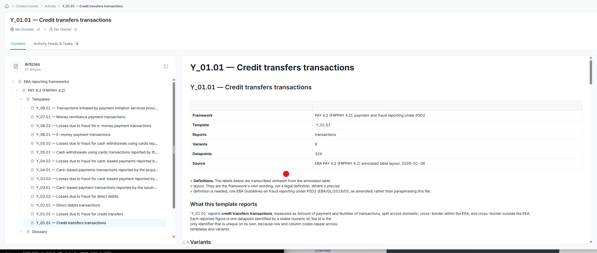
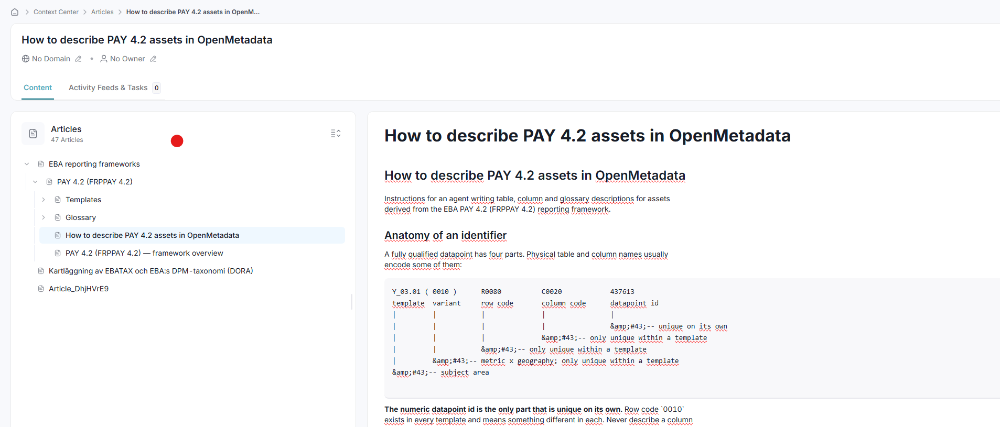

# om-eba-annotatedtpl

The EBA **PAY 4.2 (FRPPAY 4.2)** annotated table layout — payment and fraud reporting
under PSD2 — normalised from a 55-sheet spreadsheet into documentation an agent can use
when describing tables, columns and glossary terms in OpenMetadata.

**1830 datapoints · 14 templates · 14 dimensions over
4 domains · 54 controlled values.**



## What is in here

| File | What it is | Read it when |
|---|---|---|
| `01-framework.md` | What PAY 4.2 is, the 14 templates, the shape of the data | You need orientation |
| `02-agent-instructions.md` | How to decode an identifier and write a description | **Start here** |
| `07-agent-prompt.md` | The stanza to paste into an agent's system prompt, covering every framework | You are configuring an agent |
| `describe_table.py` | Writes descriptions and glossary terms onto a table's columns, by name | You are describing a real table |
| `pay42_lookup.py` | Deterministic datapoint lookup over DuckDB, and its tool definition | You are giving an agent a lookup tool |
| `agent_tools.py` | All fifteen tool definitions, one dispatcher, and a shell front end for trying one | You are wiring the tools into an agent |
| `env.sh` | `source env.sh` reads `.env`, sets the two DuckDB stores and prints every variable the pack reads, with secrets counted rather than shown | A tool reads the wrong store, or a datapoint id will not resolve |
| `dpm_lookup.py` | Nine lookups over the whole DPM 2.0 database: a template, a cell, a reported datapoint id, a report's column header, a validation code, every rule reaching a template, what a template breaks down by, the cells one dimension member covers, and which rows add up to which | A warehouse table is COREP, FINREP or anything but PAY and DORA, you need the codes behind a business aggregate, or you are reading a report or a validation outcome |
| `check_instance.py` | Runs a module's validation rules against a reported xBRL-CSV file, as a CLI and as the `check_report` tool | You want to know whether a report adds up before you send it, or want an agent to check its own arithmetic |
| `web/` | A query page in Scala.js over that tree: pick a question, fill it in, see the answer and the SQL | You want the model without installing anything |
| `source/gen_wasm_data.py` | Writes the model as partitioned parquet a browser can query with DuckDB-WASM | You are building a web page over the DPM |
| `source/apply_vr_updates.py` | Applies the EBA's between-release validation rule updates (deactivations, reactivations, severity changes) to a local DPM database | A rule's severity or activity changed since the release you downloaded |
| `source/load_to_mssql.py` | Loads the DPM database into SQL Server over TDS, authenticating with your Kerberos ticket | You want the dictionary in the same database as the reported figures |
| `display_names.py` | The rule for what a table and its columns are called | You are setting display names |
| `08-lookup-tool.md` | How to register and dispatch that tool | You are wiring it into an agent |
| `03-glossary/domains-and-members.md` | The 54 controlled values across 4 domains | You need the vocabulary |
| `03-glossary/dimensions.md` | The 14 breakdown axes | You need to know which axis a value belongs to |
| `03-glossary/metrics.md` | The 3 metrics and their units | You need the unit |
| `04-tables/<TEMPLATE>.md` | One per template: variants, columns, rows, datapoint ids | You are describing a table |
| `05-datapoints.csv` | All 1830 datapoints, keyed by `table_name` and `column_name` | You have a column to describe |
| `06-openmetadata-glossary.csv` | Bulk glossary import, 93 terms | You are loading the glossary |
| `09-validation-rules.csv` | The 185 EBA validation rules of both modules, and every cell each one reaches | You want to know what constrains a column |
| `README_DPM2.md` | The DPM 2.0 database's data model, as diagrams, with worked queries | You are querying the model directly |

## Warehouse column names

One table per template — `Y_01.01` lands in `Y_01_01` — with datapoint columns named
`Y0101_r0010_c0010`: template with its separators stripped, then row and column code.
`05-datapoints.csv` is keyed by both, as its first two fields.

Everything that does not match `^[A-Za-z][0-9]{4}_r[0-9]{4}_c[0-9]{4}$` is warehouse
context (`Period_SK`, `Company_BK`, `Taxonomy_Name`, ...) and has no framework meaning.

A column name carries no variant, so 302 of the 320 distinct names map to six datapoints
each — two metrics across three geographies — and the 18 from the `.02` loss templates
map to one. The variant is a property of the table, not the column.
`02-agent-instructions.md` has the worked example.

## Reproducing

```bash
uv sync
uv run source/extract_dpm.py    # xlsx  → source/dpm.json      (structure)
uv run source/vocab.py          # dpm   → source/vocab.json    (vocabulary)
uv run source/gen_pack.py       # both  → the markdown and CSV in this repo
uv run pytest                   # the test suite
```

CI runs the same thing on every push: `ruff check`, `ruff format --check`, `ty check`,
`pytest` on Python 3.12 and 3.14, and one job that regenerates the pack from the workbook
and fails if anything in git moved. That last one is what stops a hand edit to a generated
file from shipping — the product here *is* generated files, so without it an edit to
`README.md` or `05-datapoints.csv` would survive until the next regeneration quietly
undid it.

Dependencies are kept current by Renovate (`renovate.json`), which refreshes `uv.lock`
on a schedule rather than only when a version constraint moves, and keeps the exact
action versions in the workflow current. It needs the Renovate GitHub App installed on
the repository; GitHub's own Dependabot security alerts are separate and need no
configuration at all.

`pytest` needs nothing but the checkout. The tests that do need one of the two derived
databases - `pay42.duckdb` and the DPM 2.0 download - skip with the command that builds
it rather than failing, so a fresh clone reports what it could check.

The spreadsheet is built on merged-cell blocks: the row axis sits to the right of the
data columns, the column axis in a footer block, and the sheet axis in the header. The
merge *spans* are what identify where each block starts and ends, which is why the
extraction uses openpyxl — a plain cell reader gives you the values but not the geometry.

## The DPM 2.0 database

The annotated table layout is a spreadsheet rendering of the model. The model itself is
published as an Access database, and four scripts use it:

```bash
uv run source/fetch_dpm2.py          # download, unpack, load into DuckDB (needs mdbtools)
uv run source/check_against_dpm2.py  # does this pack match the model, cell for cell?
uv run source/extract_rules.py       # → 09-validation-rules.csv
uv run source/gen_dpm2_doc.py        # → README_DPM2.md
```

**[`README_DPM2.md`](README_DPM2.md) is the map**: the 73 tables, the relationships that
actually hold between them as four diagrams, and a worked query for each thing you are
likely to want. Read it before writing SQL against this database.

It is release 4.2.1 of the DPM 2.0 database, the same release the layout comes from, at
[the DPM data dictionary](https://www.eba.europa.eu/risk-and-data-analysis/reporting/dpm-data-dictionary). 167 MB of zip, 539 MB of Access, 139 MB of
DuckDB, all under `source/dpm2/` and all gitignored. Reading the Access file needs
`mdbtools` 1.0 or newer — the file is ACE12, and older releases read only Jet `.mdb`.

`check_against_dpm2.py` is the one check this pack cannot do on itself. It matches every
pack datapoint against the module's reportable cells, both directions, and exits non-zero
on a difference:

```
DPM 2.0 release 4.2.1 (2026-02-15)
PSD_FRP 1.1.0: all 1830 pack rows match the model, none missing
DORA 1.1.0: all 85 pack rows match the model, none missing
```

Two details it has to absorb. The DPM writes a table code `Y_01.01` where the layout and
the warehouse write `Y 01.01`. And a cell with `IsExcluded` set is a greyed-out box in
the template — in the model, not reportable — which the pack leaves out, so the
comparison does too. `Y_01.01` has 396 cells, 72 of them excluded, and the pack has 324.

### Trying a lookup before wiring it into anything

`agent_tools.py` runs any one tool from a shell, through the same dispatcher an agent
calls, and prints the answer with a plain `json.dumps` — the host's own serialisation, so
an answer it could not hand back fails here rather than mid-turn.

```bash
uv run agent_tools.py                    # the definitions the model will be shown
uv run agent_tools.py lookup_dpm_sums table='F 12.01.a' module=FINREP9 version=null
uv run agent_tools.py lookup_dpm_dimensions table=F_04.04.1 module=FINREP9 version=null
uv run agent_tools.py lookup_dpm_cells table=F_04.04.1 dimension='Counterparty sector' \
    member='Credit institutions' module=FINREP9 version=null
uv run agent_tools.py check_report table=Y_01.01 module=PSD_FRP version=1.1.0 instance=report.csv
uv run agent_tools.py explain_report instance=report.csv text=null limit=null
uv run agent_tools.py lookup_dpm_datapoint datapoint=dp152217
uv run agent_tools.py lookup_dpm_rule rule_code=v0174_m
uv run agent_tools.py lookup_dpm_rules table=C_01.00 module=COREP_OF version=null
```

Arguments are `key=value`, and `null` is spelled out, because that is what the schemas
offer for an unpinned module version. Take the dimension and member wording from
`lookup_dpm_dimensions`: a near miss matches nothing, and that is as true from the shell
as from the model.

### Questions that reach the tools

A question only reaches these tools if it carries a **template code** — `F 12.01.a`,
`F_04.04.1`, `Y_01_01`, `C_01.00`. Without one the model has nothing to pass and answers
from memory. The sequence below replaces a hand-maintained spreadsheet of row codes by
column codes, which is the job this is for. Every answer quoted is from FINREP9 3.3.0.

**The structure, instead of a YAML file of levels.**

> Which rows and columns does F_04.04.1 have, with the nesting?

`lookup_dpm_table` returns `parent_code` and `is_abstract` per entry — the hierarchy
itself. `0014 Gross carrying amount` is abstract: a heading with no cell of its own, whose
children are `0015, 0030, 0040, 0041`. An "of which" row is simply a child, so excluding
them is a filter on `parent_code` rather than a convention to maintain by hand.

**A dimension breakdown.**

> What does F_04.04.1 break down by? And which cells have Counterparty sector =
> Credit institutions?

`lookup_dpm_dimensions` first, always: it is what says that `Counterparty sector` is a
dimension of that template at all, and under which exact wording. Then
`lookup_dpm_cells`, which for that member returns 24 cells across rows `0040` (debt
securities) and `0100` (loans and advances) — both instrument blocks, which a hand-written
mapping of one block would have missed.

**The aggregate, as code.**

> Write a SQL query summing gross carrying amount for financial corporations in
> F_04.04.1 — counterparty is credit institutions or other financial corporations, the
> column sits under *Gross carrying amount*, no "of which" columns. **Every column name
> must come from `lookup_dpm_cells`; do not write one yourself.** Leave the table name a
> parameter and name the rule code you built the selection on.

Sixteen columns, `F04041_r0040_c0015` through `F04041_r0110_c0041`. The sentence in bold
is the one that matters: without it a model produces `F04041_r0070_c0015`, which looks
exactly as plausible and is not a cell.

**The grouping is yours, not the model's.**

> Build the same aggregation table as my notebook, but take the hierarchy from the DPM
> rather than from a YAML file. The grouping of counterparty sectors is my own business
> definition and must be an explicit dict in the code — not something you derive.

Rolling `Credit institutions` and `Financial corporations other than credit
institutions` up into one `Financial corporations` figure is not in the DPM. The model
holds the leaves; a roll-up across them is a decision, and it should read as one in the
code rather than arrive as though the EBA had said it. (The EBA does publish member
hierarchies, in `ATTT2Hierarchies` — no tool exposes them yet.)

**Reading a report file.**

> What is `report.csv`? Then check it.

`explain_report` answers what a report is before anything asks whether it holds: it
resolves a sample of its datapoint ids to cells and every column header to a property. It
takes a path or the report's text, so a few rows pasted into the conversation are enough.
The two fixed columns are `datapoint` and `factValue`; the rest are the open dimensions,
headed by a property code. For the EBA's own sample file:

| Column | Property |
|---|---|
| `qCDF` | Name of entity — a typed dimension, hence a free-text value |
| `qBBE` | Location of activity |
| `ei1452` | Country where a service/activity is provided |

Both halves fail in ways worth telling apart. A datapoint id above the highest this
release has means the report was built against a newer one, which the answer says rather
than leaving an empty result to interpret. That is not hypothetical: those three ids
resolve to nothing in release 4.2.1, to nothing in 4.3, and in the 4.4 draft to columns
`0040`, `0050` and `0060` of V_04.01, *Freedom to provide services*, in the
`AML_ELIGIBILITY` module - customers, incoming transactions, outgoing transactions.

An open table's key dimensions are the headers the model marks `IsKey`, and a report of
it carries exactly their property codes. V_04.01 is keyed on `qCDF`, `qBBE` and `ei1452`
— the three columns above — which `lookup_dpm_table` reports per header and
`explain_report` compares the report's columns against.

That comparison is the only check on a column that works. The first column of that sample
was read off a screenshot as `qGDF`, which resolves: *Name of Holding entity*, a real
property of the model, and the wrong one — the template's key is `qCDF`, *Name of
entity*. A header resolving to something proves nothing about whether it belongs to this
template, and only the comparison against the keys says so.

A header that resolves to nothing points at the release instead: a property code is
scoped to one, and the same property is `x21` through release 4.2 and `qx2013` after it.
And where the report has more rows than distinct datapoints, it has one row per record of
an open table, told apart by those dimension columns. Run `explain_report` before
`check_report` on any report whose provenance is not certain: one from another release
checks as "nothing mapped", which reads like a bad report rather than a newer file.

**The check, rather than an instruction not to guess.**

> Which rows add up to which in F_04.04.1 in FINREP9? Then check `report.csv` with
> `check_report` and tell me which rules failed and which could not be evaluated.

`lookup_dpm_sums` answers that row `0140` is rows `0010` and `0070` added together, over
12 columns, under rule `v23856_h` — the EBA's own rule, not arithmetic the model wrote.
`check_report` then runs every rule of that module version against the file:

```json
{ "found": true, "table": "Y_01.01", "module": "PSD_FRP 1.1.0",
  "facts": 324, "mapped": 324, "unmapped": 0,
  "hold": ["v09124_m", "v09198_s", "v09247_s"],
  "fail": [{"rule_code": "v09123_m", "severity": "warning", "fails": 12, "of": 12}],
  "not_evaluated": [] }
```

Read `not_evaluated` before `hold`: it is the checker's limit, not a pass — four of the
model's thirty-eight operators, each skipped rule named with the operator it needs. An
empty list, as here, is the claim that this module is covered completely. `unmapped` is
the next one to read: a large count almost always means the file is for another module
version rather than that the report is wrong.

Two phrases worth reusing in any of these: **"do not write any column name yourself"**,
and **"say which module version the answer is for"** — a rule changes both its expression
and its severity between versions, so a generated query should carry the version in a
comment.

### More than one release

`source/fetch_dpm2.py --release 4.3` fetches another release beside the first. Each lands
in its own files and its own database, because releases are separate downloads of
overlapping content and merging them would make "which release says this" unanswerable.
Point `DPM2_DB` at the one a lookup should read.

The default stays the release the pack is built from, so `check_against_dpm2.py` keeps
comparing like with like. What the others are for is a report that will not resolve:

| | 4.2.1 | 4.3 | 4.4 draft |
|---|---|---|---|
| Templates | 1052 | 1120 | — |
| Modules | 61 | 65 | — |
| Highest datapoint id | 1010000004 | 1010001382 | resolves the file above |

**An older module version is not restated.** Of the 145 module versions present in both
4.2.1 and 4.3, every one has exactly the same cell count, and of the 142 carrying rules,
every one has the same rule count. 4.3 adds releases and modules - `AML_RA`, `TCB_CORE`,
`TCB_HU`, `TCB_LIQUIDITY` - rather than revising what was there. So a description written
against a module version stays true as releases go by, and a figure that will not resolve
is a newer framework rather than a changed one.

### What the model has that the layout does not

Validation rules, nesting and every other framework. The first two are extracted into the
pack; the third is reachable through `dpm_lookup.py`, which reads the database directly
and so needs the download.

There are no member definitions to harvest. Of the 54 controlled values this pack
documents, the DPM publishes a definition for **none** — the 1453 items that do carry one
belong to COREP, PILLAR3, MiCA and the rest. The definitions in this pack are the only
ones there are, which is also why they must not be invented.

## Validation rules

`09-validation-rules.csv` holds the 114 rules of PSD_FRP 1.1.0 and the
71 of DORA 1.1.0, one row per rule and each cell it reaches:

| Field | |
|---|---|
| `module` | `PSD_FRP 1.1.0` or `DORA 1.1.0` |
| `rule_code`, `severity` | e.g. `v09123_m`, `warning` |
| `table_name`, `row_code`, `column_code`, `sheet_code` | the cell, in warehouse spelling; `*` is an open axis, empty is an axis the table does not have |
| `expression` | the rule in DPM-XL, verbatim |

Which cells a rule reaches is **not** parsed out of the expression. The model resolves
its own operands, in `OperandReferenceLocation`, and that is what the extraction reads —
so a rule is attached to a column because the EBA says it is, not because a regular
expression agreed. All 4635 rule-cell rows resolve to a datapoint this pack has.

A column description names the rules that reach it and stops there:

> ... Non-negative. Validation rules (EBA DPM, warning): v09123_m, v09124_m, v09247_s,
> v89551_h. v89551_h reaches only variant(s) 0030.

The expression is deliberately not in it. 93 of the 114 PAY expressions contain a plus
sign, which the OpenMetadata viewer renders as a literal `&amp;#43;` — the same reason the
build guard refuses one anywhere in this pack. The code is the handle: the EBA's own rule
lists are indexed by it, the CSV has the expression, and `lookup_datapoint` hands an agent
the whole thing under `validation_rules`.

A rule can reach only some of a column's six variants — 186 of the 845 PAY rule-column
pairs do — so the description says which, and a table that holds one variant does not
list a rule belonging to another.

### Reading a validation outcome

A validation report names a rule code and a failing cell and nothing else. `lookup_dpm_rule`
is the way back:

```bash
uv run agent_tools.py lookup_dpm_rule rule_code=v0174_m
```

```
COREP_OF   3.1.0   error    from 2023-06-30   cells 4
COREP_OF   4.0.0   error    from 2025-03-31   cells 4
COREP_OF   4.1.0   warning  from 2026-03-31   cells 4

{r0070, c0010} = the sum of {r0080, c0010}, {r0090, c0010} and {r0091, c0010}
on C_01.00
```

One row per module version, each with its own severity, the first submission date it
applies to, and the cells that version names — resolved by the model rather than parsed
out of the DPM-XL in `expression`. Which is the point of the next section.

`lookup_dpm_rules` goes the other way, from a template you are about to describe to every
rule that reaches it:

```bash
uv run agent_tools.py lookup_dpm_rules table=C_01.00 module=COREP_OF version=null
```

C_01.00 has 50 rules in COREP_OF 4.1.0 — 12 errors and 38 warnings — of which 23 reach
outside the template, and 4 more in **COREP_LE, a module C_01.00 is not part of at all**:
`v0655_m` multiplies row 0015 of C_01.00 by a column of C_28.00. Those cross-return
checks are the ones a reader is least likely to know about, which is why the template is
resolved without the module and why each rule lists every template it names.

### Taxonomy version and DPM version are different things

This is the conflation that costs the most, and the model's own column names invite it.
`ModuleVersion.VersionNumber` is the module's **taxonomy version** — FINREP9 3.3.0 — and
the **DPM version**, which is what a reporting institution usually means by "the
version", is the release the module version was introduced in:

| Module | Taxonomy version | DPM version | From | To |
|---|---|---|---|---|
| FINREP9 | 3.1.0 | 3.4 | 2022-12-31 | 2026-03-30 |
| FINREP9 | 3.2.0 | 4.0 | 2024-12-31 | 2024-12-31 |
| FINREP9 | 3.3.0 | 4.2 | 2026-03-31 | 2027-09-29 |
| FINREP9DP | 1.0.0 | 4.2 | 2026-03-31 | 2026-03-31 |
| FINREP9DP | 1.1.0 | 4.2.1 | 2026-03-31 | — |

Every lookup reports both, as `taxonomy_version` and `dpm_release`, and takes either:
`version` is the taxonomy one, `dpm_release` is the DPM one, and passing both is two
questions rather than one, so it is refused. Asking by release does the translation the
caller cannot: DPM 4.0 and 4.1 both resolve to FINREP9 3.2.0, DPM 4.2 onwards to 3.3.0.

**`FromReferenceDate` equal to `ToReferenceDate` means the module version is not to be
used.** It was published and superseded without ever covering a reporting period, so
nothing is filed under it — FINREP9 3.2.0 and FINREP9DP 1.0.0 above, and 43 of the 165
module versions in DPM 4.4. The answers mark it `do_not_use`, and resolving "the newest"
skips those, because a confident answer about a version no one files is worse than a
refusal.

### The rules change between releases, and the EBA publishes the patches

A DPM release is a snapshot. Between releases the EBA deactivates rules, reactivates them
and changes severities, and publishes each batch as a SQL script on its [validation rules
packages page](https://www.eba.europa.eu/risk-and-data-analysis/reporting/reporting-frameworks/validation-rules-packages).
The next DPM release absorbs them, so an older database is behind by every batch published
since:

```bash
uv run source/apply_vr_updates.py 'https://www.eba.europa.eu/.../DPM VR updates scripts.zip'
```

The batch of 2026-09-13 deactivates 81 rule scopes and reactivates 2. Against DPM 4.4 it
is a no-op — all 83 are already there. Against 4.2.1, 79 of them would change. Which is
the measure of what a release snapshot costs: a description written from 4.2.1 can name a
rule the EBA stopped running a year earlier.

The script is read and parsed, never executed. It arrives as SQL over the internet, and
handing that to a database is how a dictionary acquires a statement nobody read — only
`UPDATE OperationScope SET IsActive, Severity, FromSubmissionDate WHERE OperationScopeID
IN (...)` is recognised, and a file with anything else in it is refused rather than
partly applied. Without `--commit` it reports and changes nothing.

### The model as parquet, for a browser

```bash
uv run source/gen_wasm_data.py --dpm-release 4.4   # into web/public/data
```

Seven tables, pre-joined, answer every question the lookups answer — **3.05 MB for
everything DPM 4.4 ships**, in 67 files. Publishing the model's own tables instead would
be 71.6 MB, of which `ContextComposition` alone is 38.

Two things decide that, and neither is the codec. Sorting each table on the column its
questions filter by, with 50k row groups, took the dimension table from 7.58 MB to 3.26
MB — and the bytes a browser pulls for six questions from 32.9 MB to 8.3 MB, because
unsorted parquet statistics prune nothing. Splitting the three big tables by framework
takes it further: one question reads one partition. Seven questions against the published
tree pull **1.8 MB** in total, each answering in 4–17 ms.

Against those, the codec is noise — zstd 3.26 MB, zstd 22 3.14 MB, brotli 3.01 MB, gzip
3.25 MB, snappy 3.84 MB — so this writes zstd at level 22 and leaves brotli's extra 4%
alone rather than find out whether the WASM build reads it.

`.github/workflows/wasm-data.yml` builds the tree on demand and uploads it as an
artefact. It does **not** publish: the tree is derived from the EBA's DPM database, and
putting a derived copy on a public site is redistribution, which is a question for a
human rather than a workflow.

### The page over it

```bash
uv run source/gen_wasm_data.py --dpm-release 4.4   # into web/public/data/4.4
cd web && ./build.sh --js-mode release             # public/main.js, 118 kB gzipped
python3 server.py public 8097                      # any static server that speaks byte ranges
```

Each release lands in its own directory and the page offers them, because releases are
separate answers to the same question rather than versions of one. Between what 4.2.1
published and what 4.4 does, **408 rules changed severity or activity**, 1738 rules are
new and 829 are gone: `v0491_m` is active under 4.2.1 and deactivated under 4.4, which
the page shows by switching the release and asking again. The release is in the URL, so
a shared answer stays the answer it was.

Scala.js and Laminar, no npm and no bundler: Scala.js emits ES modules and the browser
resolves the DuckDB-WASM import from the CDN itself. `web/src/dpm/DuckDb.scala` is the
facade — six calls, because no Scala.js facade for DuckDB-WASM exists.

A question is a template and the slots a reader fills, never free SQL, and the answer
shows the statement that produced it. That is the same argument as everywhere else in
this pack: `F04041_r0070_c0015` looks exactly as plausible as a real cell code, so a page
that invites anyone — or any model — to write their own SQL over this schema invites the
mistake back in.

Eleven questions, which are data rather than code:

| | |
|---|---|
| Which cells does a template have? | the grid, with labels and datapoint ids |
| What does a template break down by? | dimensions and the exact wording of their members |
| Which cells make up an aggregate? | one dimension, one member — the hand-maintained spreadsheet, answered |
| Which rows add up to which? | from the rules, not from reading a grid |
| Which rules reach a template? | with the rows each names here, and how many templates it spans |
| What does a validation code mean? | per module version, with severity and whether it is still run |
| Which rules has the EBA switched off? | `active` is false: published and not run |
| What is this reported datapoint id? | `dp152217` back to its cell |
| What does a report's column header mean? | `qCDF` is *Name of entity*, and where it is a key |
| What are a template's key dimensions? | the columns a report of an open table carries |
| Which module versions…? | taxonomy version, DPM version, and `do_not_use` |

The slots offer what is there. Framework, template, module, dimension and member each
come with a list read out of the published data, and each one narrows the next: 21
frameworks, 153 templates in FINREP, nine dimensions on F_04.04.1, six members of
*Counterparty sector*. That is the near miss turned into a list — the member is
"Financial corporations other than credit institutions", and nobody was going to type
that from memory. The fields stay typeable, because a code pasted out of a report should
go straight in whether or not it is on the list, and the lists are filled when a field is
first reached for rather than on load, since filling them needs the engine.

The question and its slots live in the URL, so an answer can be sent to someone. A table
that stops at its limit says so, because one that does not reads as the whole answer.

Behind a fold, because it costs a download: a small model (SmolLM2 360M, ~376 MB, or
Qwen2.5 in 0.5B and 1.5B) loaded with WebLLM only when someone asks for it. **It never
writes SQL.** Its whole job is to pick one of the eleven questions and fill in its slots,
and the page then runs that question's own statement:

```json
{"question": "sums", "slots": {"table": "F_12.01.a", "module": "FINREP9"}}
```

That is the same argument as the rest of the pack, applied to the model: a 360M model can
choose among eleven questions, and it cannot write correct SQL over a schema where a
plausible-looking cell code is wrong and a near miss in a dimension's wording matches
nothing. What it chose is shown before the answer, so a wrong reading is visible rather
than silent, and a question id or slot name it invents is refused rather than rounded to
the nearest one.

### What is cached, and what is not

Measured rather than assumed. With `Cache-Control: max-age=600` — what GitHub Pages sends
— a second visit refetched every range, and within one session each question re-read the
files it named. So the five small tables (modules, rules, sums, headers, properties, 450
kB together) are read into the engine once per release, and the questions that use them
pull **nothing** over the wire afterwards. The partitioned tables stay on HTTP: they are
per framework, only the needed one is ever touched, and copying them into OPFS by hand
would buy less than it costs to keep correct across a release switch.

### Asking in your own words

Without WebGPU the page says so and the questions keep working — which is most of why
they exist. Checking `navigator.gpu` is not enough: Chromium exposes the object and then
returns null from `requestAdapter()` when there is no GPU to drive, so the page asks for
the adapter before sending anyone to fetch 376 MB that cannot run.
Measured in a browser: eleven questions, 15–46 ms each, 4.0 MB pulled in total including
the page itself.

### A rule code is not one rule

The same code is re-issued per module version, and both the expression and the severity
change between them. `v09247_s` is a `warning` in PSD_FRP 1.1.0 and an `error` in 1.2.0.
`09-validation-rules.csv` is scoped to the two module versions this pack describes;
`lookup_dpm_cell` is not, and returns one entry per version with the versions listed, so
two entries with the same code there are a change, not a duplicate.

## Environment

Exactly one variable is required: `OM_JWT_TOKEN`. Everything else has a default that is
right for a local checkout, so nothing has to be configured to run the generators, the
tests or a lookup.

### `OM_*` — OpenMetadata

Read by `describe_table.py` and `import_to_openmetadata.py`.

| Variable | What it is | Default |
|---|---|---|
| `OM_JWT_TOKEN` | Bearer token. **The one required variable.** | — |
| `OM_HOST` | API root. The `/api` suffix is part of it | `http://localhost:8585/api` |
| `OM_CA_BUNDLE` | Path to a CA bundle for TLS verification | the system store |
| `OM_PAGE_URL` | Format string with `{name}` where a Context Center article's name goes. Unset means the article is named in prose rather than linked, because the Context Center route changed between versions and is not documented — copy it out of the browser once | unset |
| `OM_GLOSSARY` | Which glossary root the importer writes to | `PAY_4_2` |

### `BA_*` — the warehouse

Read by `ba_form_cell.py`, the overlay that answers what a physical column actually carries.

| Variable | What it is | Default |
|---|---|---|
| `BA_SERVER` | SQL Server host. **Unset is not an error**: the warehouse is simply not consulted, and the answer says so rather than going quiet | unset |
| `BA_DATABASE` | Database | `FIDW_BI` |
| `BA_TABLE`, `BA_AXIS_TABLE` | The cell table and the axis table, joined on `Cell_sk` | `dbo.BA_Form_Cell`, `dbo.BA_Form_Axis` |
| `BA_TRUSTED_CONNECTION` | Kerberos. Set `false` to use the two below | `true` |
| `BA_USERNAME`, `BA_PASSWORD` | SQL login, only when `BA_TRUSTED_CONNECTION=false` | unset |
| `BA_DRIVER` | ODBC driver name | `ODBC Driver 18 for SQL Server` |
| `BA_ENCRYPT`, `BA_TRUST_SERVER_CERTIFICATE` | TLS on, and whether to accept a self-signed certificate | `true`, `false` |
| `BA_DEBUG` | Log the statement that ran with its parameters filled in, ready to paste into SSMS | `false` |

### `PAY42_*` — this pack's DuckDB store

| Variable | What it is | Default |
|---|---|---|
| `PAY42_DB` | The store | `pay42.duckdb` |
| `PAY42_TEMP_DIR` | Where DuckDB spills. **The one that matters in anger**: left alone it writes scratch files next to the database, so a read-only mount holding the store has nowhere to go | beside the database |
| `PAY42_EXTENSION_DIR` | Extension directory | DuckDB's own |
| `PAY42_MEMORY_LIMIT` | e.g. `2GB` | unlimited |

### `MSSQL_*` — loading the dictionary into SQL Server

Read by `source/load_to_mssql.py`. Kerberos by default, so with `MSSQL_SERVER` set and a
`kinit` ticket there is nothing else to configure and no password to keep.

| Variable | What it is | Default |
|---|---|---|
| `MSSQL_SERVER` | Host. No default: there is nothing sensible to guess | — |
| `MSSQL_PORT` | | `1433` |
| `MSSQL_DATABASE` | The target database, which must already exist | `DPM2` |
| `MSSQL_SCHEMA` | The target schema, created if absent. Also accepted as `MSSQL_DB_SCHEMA`, because the field cannot be called `schema` — Pydantic has that name | `dpm` |
| `MSSQL_TRUSTED_CONNECTION` | Kerberos. `Trusted_Connection=yes` resolves to `authenticator=krb5` on POSIX. Set `false` to use the two below | `true` |
| `MSSQL_USERNAME`, `MSSQL_PASSWORD` | A SQL login; both are required once the trusted connection is off | unset |
| `MSSQL_ENCRYPT`, `MSSQL_TRUST_SERVER_CERTIFICATE` | TLS on, and whether to accept a self-signed certificate | `true`, `false` |

So the default target is `DPM2.dpm`. The T-SQL in
[`README_DPM2.md`](README_DPM2.md) writes that schema literally, as `dpm.RuleSum` and
`dpm.Operation`; point `MSSQL_SCHEMA` somewhere else and those queries need the same
rename.

### `DPM2_*` — the DPM 2.0 database

| Variable | What it is | Default |
|---|---|---|
| `DPM2_DIR` | The download directory: the zip, the Access file and the DuckDB database | `source/dpm2/` |
| `DPM2_DB` | The database file alone. It wins over the release being fetched, so a second release wants it unset on the way in and set on the way out | `dpm2.duckdb` inside `DPM2_DIR`, and `dpm2_4_3.duckdb` for a release that is not the default |

### Seeing what is actually set

```bash
source env.sh                     # .env, then the defaults, then the report
source env.sh --release 4.4       # point DPM2_DB at another release's database
source env.sh --quiet             # set without the report; `pack_env` prints it later
source env.sh --env-file other.env   # read that instead of ./.env
source env.sh --no-env-file          # ignore it
```

It reads `.env` first, then fills in what has a safe local default - the two stores and
the download directory. The precedence is pydantic-settings' own: **the environment wins
over `.env`, and `.env` wins over the defaults here**, so exporting a variable for one
command still overrides the file, and a release pinned for one shell stays pinned. This
is also what closes the gap the next section describes: `DPM2_*` is read with `os.environ`
and never reaches pydantic-settings, so until now a `.env` could not pin it.

The file is read, never executed. `source .env` runs whatever is in it, and a file holding
a password is the last one to hand a shell, so this parses `NAME=VALUE` only: `export` is
allowed, comments and blanks skipped, one pair of surrounding quotes removed, and nothing
expanded - `$HOME` in a value stays the five characters it is. Secrets and hostnames are
still never *assigned* by the script itself: a committed file that sets `OM_JWT_TOKEN` is
a committed file that leaks it, and a default SQL Server host is a wrong host.

The report names every variable the pack reads, marks the ones this run took from the
file with `(.env)`, says whether each path exists, counts a secret rather than printing
it, and for `DPM2_DB` opens the database to say which releases it contains and what its
highest datapoint id is:

```
DPM2_DB    .../source/dpm2/dpm2_4_4.duckdb  [158M]
           releases 3.4, 3.5, 4.0, 4.1, 4.2, 4.2.1, 4.2.1.1, 4.2.1.2, 4.3, 4.3.0.1, 4.4;
           highest datapoint id 1010005111
```

That last line is the one worth having. No variable says which release a file holds, and
a datapoint that will not resolve is almost always a database older than the report.

### A `.env` file does not cover all of them

`OM_*`, `BA_*` and `PAY42_*` as the lookup reads them go through pydantic-settings, which
reads `.env`. `DPM2_*` everywhere, and `PAY42_DB` and `PAY42_TEMP_DIR` as
`source/build_duckdb.py` reads them, use `os.environ` and do not.

So a `PAY42_DB` in `.env` steers where a lookup reads but not where the build writes: you
can build one file and read another with nothing complaining, and `DPM2_*` in `.env` does
nothing at all — to the tools. `source env.sh` is the way round it: it reads the file
itself and exports what it finds, so one `.env` then governs every variable here.

## Importing into OpenMetadata

```bash
export OM_HOST=https://your-host/api      # the /api suffix is required
export OM_JWT_TOKEN=...
uv run import_to_openmetadata.py --dry-run
uv run import_to_openmetadata.py --pages-only
uv run import_to_openmetadata.py --glossary-only --commit
```

| Flag | Effect |
|---|---|
| `--dry-run` | Print the page tree and stop. Contacts nothing. |
| `--pages-only` | Knowledge Pages only, skip the glossary |
| `--glossary-only` | Glossary only, skip the pages |
| `--commit` | Actually write the glossary terms. Without it, only the first pass is dry run. |
| `--reset-glossary` | **Destructive.** Hard-delete the glossary and its terms first. |
| `--verify` | Compare the database listing with the search-index listing, then stop |
| `--no-reindex` | Do not reindex after writing pages |

Markdown goes to Knowledge Pages (`PUT /v1/contextCenter/pages`) under an `EBA` root, so
a later framework can be loaded beside this one:

    EBA
    └── PAY 4.2 (FRPPAY 4.2)
        ├── Framework
        ├── Agent instructions
        ├── Agent prompt
        ├── Glossary      (dimensions, domains and members, metrics)
        └── Templates     (one page per template)

There is no bulk file upload and no document library — `docStore/document.json` is a
generic JSON payload store the UI uses for persona layouts.



### The glossary import runs in passes

The CSV holds glossary **terms**; it does not create the glossary, so the importer does
that first. Then it sends the terms one level at a time.

A term's parent is resolved against the database, and a dry run persists nothing, so a
term whose parent sits in the same file can never validate — on a freshly created, empty
glossary the import answers `Entity not found: glossaryTerm <uuid>`, naming a reference
that only ever existed in memory. The passes are therefore:

| Pass | Terms | |
|---|---|---|
| 1 | 3 | `Domains`, `Dimensions`, `Metrics` |
| 2 | 21 | the domains, dimensions and metrics themselves |
| 3 | 54 | the members |
| 4 | 14 | the rows carrying `relatedTerms`, which point from a dimension to a domain on the same level |

Each pass is dry run and then committed before the next begins, so **without `--commit`
only the first pass can be checked** — the later ones have nothing to resolve against yet.

Terms are created as `Draft` except the three grouping terms. Promote them once a domain
expert has checked the definitions: the descriptions here are structural, they say where
a term is used, not what it legally means.

### Doing it by hand

```bash
AUTH="Authorization: Bearer $OM_JWT_TOKEN"

curl -X POST "$OM_HOST/v1/glossaries" -H "$AUTH" -H 'Content-Type: application/json' -d '{"name": "PAY_4_2", "displayName": "PAY 4.2 (FRPPAY 4.2)", "description": "..."}'

curl -X PUT "$OM_HOST/v1/glossaries/name/PAY_4_2/import?dryRun=true" -H "$AUTH" -H 'Content-Type: text/plain' --data-binary @06-openmetadata-glossary.csv
```

The second call imports the whole file at once and **will fail** for the reason above;
split it by level first, or use the script. The header comes from
`json/data/glossary/glossaryCsvDocumentation.json` in the OpenMetadata source:
`parent, name*, displayName, description, synonyms, relatedTerms, references, tags,
reviewers, owner, glossaryStatus, color, iconURL, domains, extension`. Check it against
your own instance — `GET /v1/glossaries/documentation/csv` returns what your server
expects. An empty `parent` puts a term directly under the glossary.

The glossary is named `PAY_4_2`, not `PAY 4.2`, and carries the readable form in its
displayName. OpenMetadata quotes any FQN part containing a dot, so a glossary called
`PAY 4.2` is addressed as `"PAY 4.2".Domains`; a parent column written `PAY 4.2.Domains`
then matches nothing and every child row fails with `Entity ... not found`.

`Payment related parties` appears twice, once as a domain and once as a dimension. That
is deliberate — dimension `qKKL` carries the same label as its domain `qRP` — and the two
have different parents, so the FQNs do not collide.

## Troubleshooting

### A re-run does not change a page

`EntityRepository.updateDescription` reverts a PUT that would replace a non-empty
description when the caller is a **bot**, and answers 200 as if it had worked. A second
import from a bot token therefore leaves the old text in place while every line prints a
tick. The importer detects this and falls back to PATCH, which the server's own comment
names as the way round it; if that is refused too, the run ends by naming the pages that
kept their old body. Use a user token, or delete the pages so they are created fresh.

### Pages written but missing from the list

The UI lists pages through `/search/hierarchy`, which reads the search index, while the
write goes to the database. Indexing is asynchronous, so a fresh import can be invisible
in every list view. The importer reindexes the ids it wrote; `--verify` shows the two
counts side by side.

### The diagrams or quotes look wrong

Descriptions are sanitised on write by an OWASP HTML policy, which HTML-escapes as it
goes: a plus sign comes back as a numeric character reference, and a greater-than sign as
`&gt;`. ASCII tree connectors and markdown blockquotes do not survive. The generator
draws with box characters, uses fenced blocks instead of quotes, and fails the build if a
plus sign reaches any page.

## Licence

The code is MIT (see `LICENSE`). The PAY 4.2 content — codes, labels, datapoint ids,
structure and the source workbook — is EBA material, reproduced under the EBA legal
notice, which authorises reproduction provided the source is acknowledged. That is a
permission with an attribution condition, not a named open licence, and the MIT licence
does not extend to it. See `NOTICE`. Not affiliated with or endorsed by the EBA.

## The one thing to get right

Row code `0010` and column code `0010` exist in every template and mean something
different in each. Only the numeric **datapoint id** is unique on its own. Resolve to a
datapoint id before writing any description.
